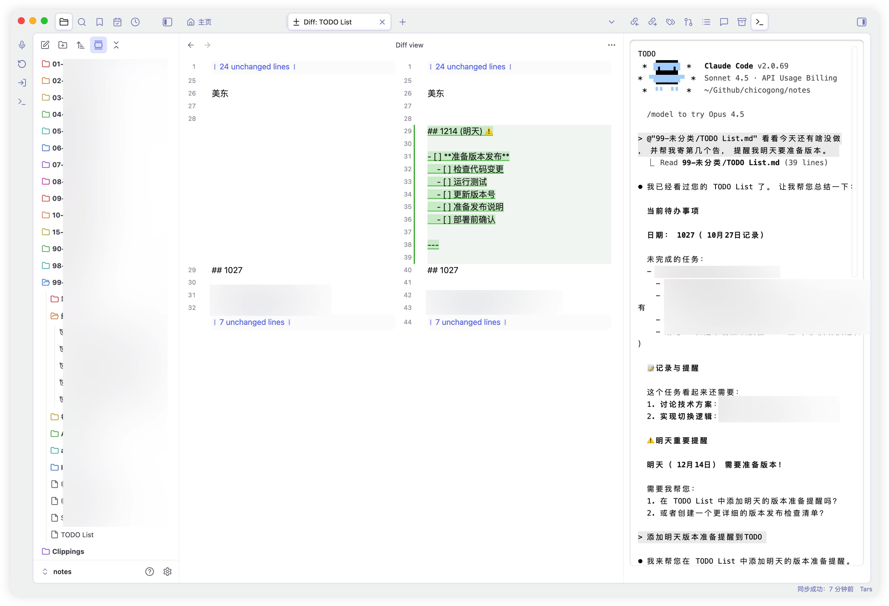
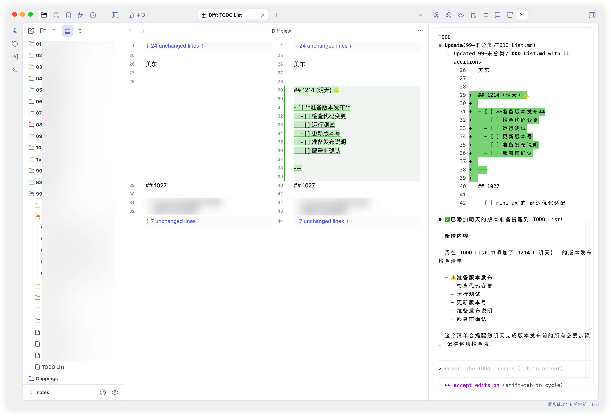

# ClaudeTerm

<p align="center">
  <a href="README.md">English</a> | <a href="README.zh-CN.md">简体中文</a>
</p>

<p align="center">
  
  
  
</p>

<h3 align="center">🚀 Full-featured terminal for Obsidian</h3>
<p align="center">Run <strong>AI CLI tools</strong> (Claude, Gemini, OpenAI, OpenCode), vim, git directly in your sidebar</p>

<p align="center">
  
</p>

---

## 🎬 What Can You Do?

### 🤖 AI-Powered Note-Taking

Run all major AI CLI tools **side-by-side with your notes**:

```bash
# Claude Code - AI pair programming
claude
claude -p "Help me refactor this code"

# Google Gemini CLI
gemini "Summarize my meeting notes"

# OpenAI ChatGPT / Codex
chatgpt "Generate unit tests for this function"

# OpenCode - open-source coding agent
# Install OpenCode first, then launch it like any other interactive CLI.
opencode
```

ClaudeTerm is a general PTY terminal rather than a vendor-specific integration. OpenCode needs no plugin adapter: if `opencode` works in your system terminal and is available on the configured shell `PATH`, it works inside ClaudeTerm as well.

**Perfect workflow:**
1. Write notes about a problem in Obsidian
2. Press `Cmd+Shift+T` to open terminal
3. Ask AI for help **without leaving your notes**
4. Copy AI's response back to your notes

<p align="center">
  
</p>

### 🔄 Perfect with Obsidian Git Plugin

**Install Obsidian Git for automatic version control:**

1. **Install Obsidian Git Plugin:**
   - Go to `Settings` → `Community plugins` → `Browse`
   - Search for "Obsidian Git"
   - Click `Install` and `Enable`

2. **Visual Git Operations:**
   - Obsidian Git provides a **visual interface** for Git
   - Auto-commit and sync on schedule
   - View changes with built-in diff viewer
   - Stage/unstage files with clicks

3. **Use ClaudeTerm for Advanced Operations:**
   - When you need git commands, ClaudeTerm is right there
   - Quick `git status` to check changes
   - Run custom git commands when needed
   - Edit commit messages in vim/nano

**Perfect combo:**
- ✅ Obsidian Git handles automatic syncing
- ✅ ClaudeTerm for when you need terminal control
- ✅ Both work together seamlessly
- ✅ Best of both worlds: GUI + CLI

### 💻 Full Terminal Experience

Run any command just like in a native terminal - vim, python, npm, docker, and more. All tools work seamlessly.

## 📦 Installation

### Step 1: Install Prerequisites

**Check if Python 3 is installed:**

```bash
python3 --version
# Should show: Python 3.x.x
```

**If not installed:**

- **macOS**: `brew install python3`
- **Ubuntu/Debian**: `sudo apt install python3`
- **Other Linux**: Use your package manager

### Step 2: Install ClaudeTerm Plugin

#### Method A: Using BRAT (Recommended for beginners)

1. **Install BRAT plugin first:**
   - Open Obsidian
   - Go to `Settings` → `Community plugins`
   - Click `Browse` and search for "BRAT"
   - Install and enable BRAT

2. **Add ClaudeTerm via BRAT:**
   - Go to `Settings` → `BRAT`
   - Click `Add Beta plugin`
   - Enter: `chicogong/obsidian-claude-code`
   - Click `Add Plugin`

3. **Enable ClaudeTerm:**
   - Go to `Settings` → `Community plugins`
   - Find "ClaudeTerm" and toggle it ON

#### Method B: Manual Installation (Step by step)

**Step 1: Find your vault's plugin folder**

1. Open Obsidian
2. Right-click any note → `Show in system explorer` / `在系统中显示`
3. You'll see your vault folder open
4. Look for the `.obsidian` folder:
   - **macOS/Linux**: Press `Cmd+Shift+.` to show hidden files
   - **Windows**: Enable "Show hidden files" in File Explorer
5. Open `.obsidian` → `plugins` folder

Your path should look like:
- **macOS**: `/Users/YourName/Documents/Obsidian/YourVault/.obsidian/plugins/`
- **Linux**: `/home/YourName/Documents/Obsidian/YourVault/.obsidian/plugins/`
- **Windows**: Not supported yet (see Roadmap)

**Step 2: Download the plugin**

**Option A: Using Git (Recommended)**

Open Terminal/Command Prompt and run:

```bash
# Navigate to plugins folder (replace with your actual path)
cd /Users/YourName/Documents/Obsidian/YourVault/.obsidian/plugins/

# Clone the repository
git clone https://github.com/chicogong/obsidian-claude-code.git claudeterm

# Done! The 'claudeterm' folder is now created
```

**Option B: Download ZIP**

1. Go to https://github.com/chicogong/obsidian-claude-code
2. Click green `Code` button → `Download ZIP`
3. Extract the ZIP file
4. Rename the extracted folder to `claudeterm`
5. Move the `claudeterm` folder to `.obsidian/plugins/`

**Step 3: Verify files**

Open the `claudeterm` folder and make sure you see these files:
```
claudeterm/
├── main.js           ✓ Must have
├── manifest.json     ✓ Must have
├── styles.css        ✓ Must have
├── pty_proxy.py      ✓ Must have
└── README.md         (optional)
```

**Step 4: Enable the plugin**

1. Restart Obsidian (completely close and reopen)
2. Go to `Settings` → `Community plugins`
3. Look for "ClaudeTerm" in the list
4. Toggle it ON (the switch should turn purple)
5. You should now see a terminal icon in the left ribbon!

**Troubleshooting:**

If ClaudeTerm doesn't appear in the plugin list:
1. Check folder name is exactly `claudeterm` (lowercase, no spaces)
2. Make sure files are directly in `claudeterm/`, not in a subfolder
3. Close Obsidian completely and reopen
4. Check if `manifest.json` exists and is valid

### Step 3: Configure ClaudeTerm

1. **Open Settings:**
   - `Settings` → `ClaudeTerm`

2. **Choose a theme:**
   - Light (default) - Clean and professional
   - Dark - Easy on the eyes
   - Custom - Design your own colors

3. **Configure behavior:**
   - ✅ **Auto-cd to note directory** (Recommended ON)
     - Terminal opens in current note's folder
     - Perfect for running commands related to your notes

## 🚀 How to Use

### Opening the Terminal

**Method 1: Ribbon Icon** (Easiest)
- Click the terminal icon (📟) in the left sidebar

**Method 2: Command Palette**
- Press `Cmd+P` (Mac) or `Ctrl+P` (Windows/Linux)
- Type "Open Terminal"
- Press Enter

**Method 3: Keyboard Shortcut** (Fastest)
- Set it up in `Settings` → `Hotkeys`
- Search for "ClaudeTerm"
- Recommended: `Cmd+Shift+T` or `Ctrl+Shift+T`

### Available Commands

Customize shortcuts in `Settings` → `Hotkeys`:

| Command | What it does | Suggested Shortcut |
|---------|-------------|-------------------|
| **Open Terminal** | Open or focus terminal | - |
| **Toggle Terminal** | Show/Hide terminal | `Cmd+Shift+T` |
| **Focus Terminal** | Jump to terminal | `Cmd+K Cmd+T` |
| **Clear Terminal** | Clear screen | - |
| **Restart Terminal** | Restart shell | - |

### Terminal Features

**Auto-cd to note directory:**
```bash
# When editing: Projects/MyApp/notes.md
pwd
# → /vault/Projects/MyApp

# Perfect for project-specific commands!
npm test
git status
```

**All terminal features work:**
- ✅ Interactive commands (vim, nano, htop)
- ✅ Colors and formatting
- ✅ Tab completion
- ✅ Command history (↑/↓ arrows)
- ✅ Ctrl+C to cancel
- ✅ Copy/paste

## 🎨 Themes & Customization

### Built-in Themes

**Light Theme (Default)**
- Professional look
- Perfect for daytime use
- Matches Obsidian's light mode

**Dark Theme**
- Easy on the eyes
- Great for nighttime
- Matches Obsidian's dark mode

### Custom Theme

**Full control over terminal colors:**

1. Enable custom theme in settings
2. Customize each color:
   - Background & Foreground
   - Cursor & Selection
   - All 16 ANSI colors (black, red, green, etc.)
3. Preview changes instantly
4. Reset to defaults anytime

## 🔧 Troubleshooting

### Terminal won't open

**Problem**: "Failed to start Python proxy"

**Solution**:
1. Check Python installation:
   ```bash
   which python3
   ```
2. If not found, install Python 3
3. Restart Obsidian
4. Try opening terminal again

### Plugin not showing up

**Check these:**
1. ✅ Folder name is `claudeterm` (not `obsidian-claude-code`)
2. ✅ Files exist: `manifest.json`, `main.js`, `pty_proxy.py`
3. ✅ Plugin is enabled in settings
4. ✅ Restart Obsidian

### Terminal looks weird

**Solutions:**
1. Try switching themes (Light ↔ Dark)
2. Resize Obsidian window
3. Use "Restart Terminal" command
4. Check if Python 3 is working: `python3 --version`

### Characters appear twice

**Already fixed in current version!**

If you still see it:
1. Update to latest version
2. Use "Restart Terminal" command

## 🗺️ Roadmap

### ✅ Completed Features

- [x] Full terminal emulation (PTY support)
- [x] All AI CLI tools (Claude, Gemini, OpenAI)
- [x] Git integration (perfect with Obsidian Git)
- [x] Custom themes (Light/Dark/Custom)
- [x] Auto-cd to note directory
- [x] Keyboard shortcuts

### 🔮 Coming Soon

- [ ] **Windows support** - Using conpty/winpty
- [ ] **Multiple tabs** - Switch between terminals
- [ ] **Session persistence** - Remember state on restart
- [ ] **Visual git diff** - See changes in Obsidian UI
- [ ] **AI shortcuts** - Quick commands for AI tools
- [ ] **Terminal profiles** - Save different configurations

## 💡 Tips & Tricks

### Combine with Obsidian Git

Install [Obsidian Git plugin](https://github.com/denolehov/obsidian-git) alongside ClaudeTerm:

1. Obsidian Git auto-syncs your vault
2. Use ClaudeTerm to review changes: `git diff`
3. Stage specific changes: `git add -p`
4. Commit with detailed messages
5. Perfect workflow for version control!

### Use with AI CLI Tools

**Claude Code:**
```bash
claude           # Interactive mode
claude -p "..."  # One-shot prompt
```

**Gemini CLI:**
```bash
gemini "question"
gemini -m gemini-pro "complex task"
```

**OpenAI:**
```bash
chatgpt "question"
openai "generate code for..."
```

### Quick File Editing

```bash
# Edit in vim
vim notes.md

# Edit in nano (easier for beginners)
nano notes.md

# Quick changes
echo "# New note" > temp.md
```

## 🤝 Contributing

Contributions welcome!

**Found a bug?** [Open an issue](https://github.com/chicogong/obsidian-claude-code/issues)

**Have an idea?** [Start a discussion](https://github.com/chicogong/obsidian-claude-code/discussions)

**Want to help?**
```bash
git clone https://github.com/chicogong/obsidian-claude-code.git
cd obsidian-claude-code
# Edit code
# Test in Obsidian (Cmd+R to reload)
# Submit PR
```

See [ARCHITECTURE.md](ARCHITECTURE.md) for technical details.

## 📄 License

MIT License - see [LICENSE](LICENSE)

Free to use, modify, and distribute!

## 🙏 Credits

Built with:
- [xterm.js](https://xtermjs.org/) - Terminal emulator
- [Obsidian](https://obsidian.md/) - Note-taking platform
- [Obsidian Git](https://github.com/denolehov/obsidian-git) - Git integration

Supports:
- [Claude Code](https://claude.ai/code) - AI coding assistant
- [Google Gemini](https://ai.google.dev/) - AI assistant
- [OpenAI](https://openai.com/) - AI platform
- [OpenCode](https://github.com/anomalyco/opencode) - open-source coding agent

Inspired by [obsidian-terminal](https://github.com/polyipseity/obsidian-terminal)

---

<p align="center">
  <strong>Made with ❤️ for developers who live in Obsidian</strong>
</p>

<p align="center">
  <a href="https://github.com/chicogong/obsidian-claude-code/issues">Report Bug</a>
  ·
  <a href="https://github.com/chicogong/obsidian-claude-code/issues">Request Feature</a>
  ·
  <a href="https://github.com/chicogong/obsidian-claude-code/discussions">Discussions</a>
</p>
