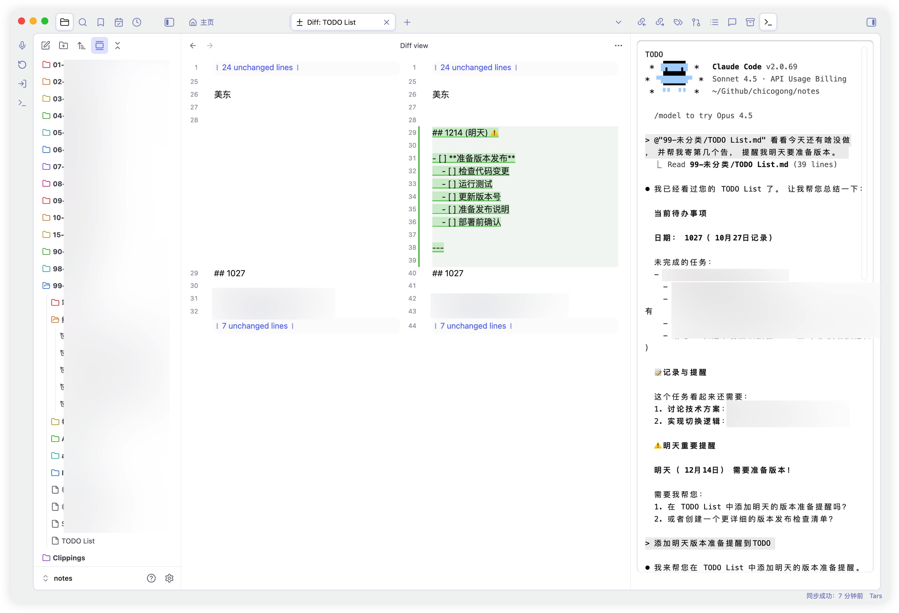
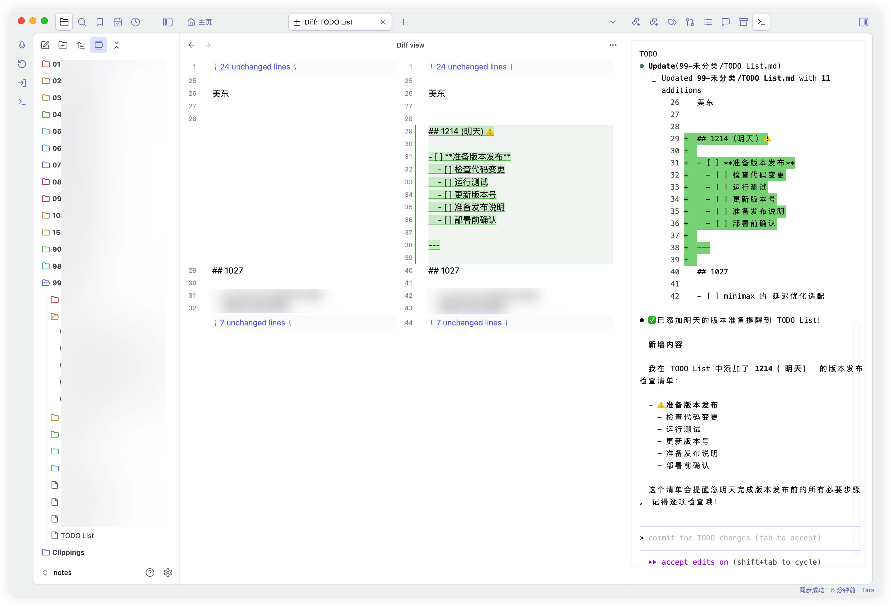

# ClaudeTerm

<p align="center">
  <a href="README.md">English</a> | <a href="README.zh-CN.md">简体中文</a>
</p>

<p align="center">
  
  
  
</p>

<h3 align="center">🚀 Obsidian 的全功能终端插件</h3>
<p align="center">在侧边栏直接运行 <strong>AI CLI 工具</strong>（Claude、Gemini、OpenAI）、vim、git 等所有命令</p>

<p align="center">
  
</p>

---

## 🎬 能做什么？

### 🤖 AI 增强笔记

在笔记旁边直接运行所有主流 AI CLI 工具：

```bash
# Claude Code - AI 编程助手
claude
claude -p "帮我重构这段代码"

# Google Gemini CLI
gemini "总结我的会议笔记"

# OpenAI ChatGPT / Codex
chatgpt "为这个函数生成单元测试"
```

**完美工作流：**
1. 在 Obsidian 中记录问题笔记
2. 按 `Cmd+Shift+T` 打开终端
3. 向 AI 求助**无需离开笔记**
4. 把 AI 的回答复制回笔记

<p align="center">
  
</p>

### 🔄 完美配合 Obsidian Git 插件

**安装 Obsidian Git 实现自动版本控制：**

1. **安装 Obsidian Git 插件：**
   - 进入 `设置` → `第三方插件` → `浏览`
   - 搜索 "Obsidian Git"
   - 点击 `安装` 并 `启用`

2. **可视化 Git 操作：**
   - Obsidian Git 提供**可视化界面**操作 Git
   - 定时自动提交和同步
   - 内置差异查看器查看变更
   - 点击即可暂存/取消暂存文件

3. **需要高级操作时使用 ClaudeTerm：**
   - 需要 git 命令时，ClaudeTerm 就在旁边
   - 快速 `git status` 查看状态
   - 运行自定义 git 命令
   - 用 vim/nano 编辑提交信息

**完美组合：**
- ✅ Obsidian Git 处理自动同步
- ✅ ClaudeTerm 提供终端控制能力
- ✅ 两者无缝配合
- ✅ 兼得图形界面和命令行的优势

### 💻 开发者工作流

```bash
# 编辑文件
vim README.md
nano config.txt

# 运行代码
python3 script.py
node app.js

# 项目管理
npm test
make build
docker-compose up

# 搜索笔记
grep -r "TODO" .
fd "*.md" | xargs wc -l
```

## 📦 安装教程

### 第一步：安装 Python 3

**检查是否已安装：**

```bash
python3 --version
# 应该显示: Python 3.x.x
```

**如果没有安装：**

- **macOS**: `brew install python3`
- **Ubuntu/Debian**: `sudo apt install python3`
- **其他 Linux**: 使用你的包管理器

### 第二步：安装 ClaudeTerm 插件

#### 方法 A：使用 BRAT（推荐新手）

1. **先安装 BRAT 插件：**
   - 打开 Obsidian
   - 进入 `设置` → `第三方插件`
   - 点击 `浏览` 搜索 "BRAT"
   - 安装并启用 BRAT

2. **通过 BRAT 添加 ClaudeTerm：**
   - 进入 `设置` → `BRAT`
   - 点击 `Add Beta plugin`
   - 输入：`chicogong/obsidian-cladue-code`
   - 点击 `Add Plugin`

3. **启用 ClaudeTerm：**
   - 进入 `设置` → `第三方插件`
   - 找到 "ClaudeTerm" 并打开开关

#### 方法 B：手动安装（详细步骤）

**第 1 步：找到笔记库的插件文件夹**

1. 打开 Obsidian
2. 右键点击任意笔记 → `在系统中显示`
3. 会打开你的笔记库文件夹
4. 找到 `.obsidian` 文件夹：
   - **macOS/Linux**: 按 `Cmd+Shift+.` 显示隐藏文件
   - **Windows**: 在文件资源管理器中启用"显示隐藏文件"
5. 打开 `.obsidian` → `plugins` 文件夹

路径应该类似：
- **macOS**: `/Users/你的用户名/Documents/Obsidian/你的笔记库/.obsidian/plugins/`
- **Linux**: `/home/你的用户名/Documents/Obsidian/你的笔记库/.obsidian/plugins/`
- **Windows**: `C:\Users\你的用户名\Documents\Obsidian\你的笔记库\.obsidian\plugins\`

**第 2 步：下载插件**

**方式 A：使用 Git（推荐）**

打开终端（macOS/Linux）或命令提示符（Windows），运行：

```bash
# 进入插件文件夹（替换成你的实际路径）
cd /Users/你的用户名/Documents/Obsidian/你的笔记库/.obsidian/plugins/

# 克隆仓库
git clone https://github.com/chicogong/obsidian-cladue-code.git claudeterm

# 完成！现在已经创建了 'claudeterm' 文件夹
```

**方式 B：下载 ZIP 压缩包**

1. 访问 https://github.com/chicogong/obsidian-cladue-code
2. 点击绿色的 `Code` 按钮 → `Download ZIP`
3. 解压下载的 ZIP 文件
4. 将解压后的文件夹重命名为 `claudeterm`
5. 把 `claudeterm` 文件夹移动到 `.obsidian/plugins/` 目录

**第 3 步：验证文件**

打开 `claudeterm` 文件夹，确保看到这些文件：
```
claudeterm/
├── main.js           ✓ 必须有
├── manifest.json     ✓ 必须有
├── styles.css        ✓ 必须有
├── pty_proxy.py      ✓ 必须有
└── README.md         （可选）
```

**第 4 步：启用插件**

1. 完全重启 Obsidian（关闭后重新打开）
2. 进入 `设置` → `第三方插件`
3. 在列表中找到 "ClaudeTerm"
4. 打开开关（开关应该变成紫色）
5. 现在左侧边栏应该出现终端图标了！

**故障排查：**

如果 ClaudeTerm 没有出现在插件列表中：
1. 检查文件夹名是否正好是 `claudeterm`（小写，无空格）
2. 确保文件直接在 `claudeterm/` 目录下，不是在子文件夹里
3. 完全关闭 Obsidian 后重新打开
4. 检查 `manifest.json` 文件是否存在且有效

### 第三步：配置 ClaudeTerm

1. **打开设置：**
   - `设置` → `ClaudeTerm`

2. **选择主题：**
   - Light（默认）- 简洁专业
   - Dark - 护眼
   - Custom - 自定义颜色

3. **配置行为：**
   - ✅ **自动切换到笔记目录**（推荐开启）
     - 终端在当前笔记的文件夹中打开
     - 方便运行与笔记相关的命令

## 🚀 使用方法

### 打开终端

**方法 1：侧边栏图标**（最简单）
- 点击左侧边栏的终端图标（📟）

**方法 2：命令面板**
- 按 `Cmd+P`（Mac）或 `Ctrl+P`（Windows/Linux）
- 输入 "Open Terminal"
- 回车

**方法 3：键盘快捷键**（最快）
- 在 `设置` → `快捷键` 中设置
- 搜索 "ClaudeTerm"
- 推荐：`Cmd+Shift+T` 或 `Ctrl+Shift+T`

### 可用命令

在 `设置` → `快捷键` 中自定义：

| 命令 | 功能 | 推荐快捷键 |
|------|------|-----------|
| **Open Terminal** | 打开或聚焦终端 | - |
| **Toggle Terminal** | 显示/隐藏终端 | `Cmd+Shift+T` |
| **Focus Terminal** | 跳转到终端 | `Cmd+K Cmd+T` |
| **Clear Terminal** | 清空屏幕 | - |
| **Restart Terminal** | 重启 shell | - |

### 终端功能

**自动切换到笔记目录：**
```bash
# 编辑笔记: Projects/MyApp/notes.md 时
pwd
# → /vault/Projects/MyApp

# 直接运行项目命令！
npm test
git status
```

**所有终端功能都支持：**
- ✅ 交互式命令（vim、nano、htop）
- ✅ 颜色和格式
- ✅ Tab 补全
- ✅ 命令历史（↑/↓ 箭头）
- ✅ Ctrl+C 取消
- ✅ 复制粘贴

## 🎨 主题和自定义

### 内置主题

**Light 主题（默认）**
- 专业外观
- 适合白天使用
- 匹配 Obsidian 亮色模式

**Dark 主题**
- 护眼
- 适合夜间使用
- 匹配 Obsidian 暗色模式

### 自定义主题

**完全控制终端颜色：**

1. 在设置中启用自定义主题
2. 自定义每种颜色：
   - 背景和前景色
   - 光标和选区
   - 所有 16 种 ANSI 颜色（黑、红、绿等）
3. 即时预览更改
4. 随时重置为默认

## 🔧 故障排查

### 终端打不开

**问题**："Failed to start Python proxy"

**解决方法**：
1. 检查 Python 安装：
   ```bash
   which python3
   ```
2. 如果找不到，安装 Python 3
3. 重启 Obsidian
4. 再次尝试打开终端

### 插件没显示

**检查这些：**
1. ✅ 文件夹名是 `claudeterm`（不是 `obsidian-cladue-code`）
2. ✅ 文件存在：`manifest.json`、`main.js`、`pty_proxy.py`
3. ✅ 插件已在设置中启用
4. ✅ 重启 Obsidian

### 终端显示异常

**解决方法：**
1. 尝试切换主题（Light ↔ Dark）
2. 调整 Obsidian 窗口大小
3. 使用 "Restart Terminal" 命令
4. 检查 Python 3 是否正常：`python3 --version`

### 字符重复显示

**当前版本已修复！**

如果仍然出现：
1. 更新到最新版本
2. 使用 "Restart Terminal" 命令

## 🗺️ 路线图

### ✅ 已完成功能

- [x] 完整终端模拟（PTY 支持）
- [x] 所有 AI CLI 工具（Claude、Gemini、OpenAI）
- [x] Git 集成（完美配合 Obsidian Git）
- [x] 自定义主题（Light/Dark/Custom）
- [x] 自动切换到笔记目录
- [x] 键盘快捷键

### 🔮 计划中

- [ ] **Windows 支持** - 使用 conpty/winpty
- [ ] **多标签页** - 在多个终端间切换
- [ ] **会话持久化** - 重启后恢复状态
- [ ] **可视化 git diff** - 在 Obsidian UI 中查看变更
- [ ] **AI 快捷命令** - AI 工具的快捷操作
- [ ] **终端配置文件** - 保存不同的配置

## 💡 使用技巧

### 配合 Obsidian Git 使用

同时安装 [Obsidian Git 插件](https://github.com/denolehov/obsidian-git)和 ClaudeTerm：

1. Obsidian Git 自动同步笔记库
2. 用 ClaudeTerm 查看变更：`git diff`
3. 选择性暂存：`git add -p`
4. 提交详细说明
5. 完美的版本控制工作流！

### 配合 AI CLI 工具

**Claude Code：**
```bash
claude           # 交互模式
claude -p "..."  # 单次提示
```

**Gemini CLI：**
```bash
gemini "问题"
gemini -m gemini-pro "复杂任务"
```

**OpenAI：**
```bash
chatgpt "问题"
openai "生成代码..."
```

### 快速编辑文件

```bash
# 用 vim 编辑
vim notes.md

# 用 nano 编辑（对新手更友好）
nano notes.md

# 快速修改
echo "# 新笔记" > temp.md
```

## 🤝 贡献

欢迎贡献！

**发现 bug？** [提交 issue](https://github.com/chicogong/obsidian-cladue-code/issues)

**有想法？** [开始讨论](https://github.com/chicogong/obsidian-cladue-code/discussions)

**想帮忙？**
```bash
git clone https://github.com/chicogong/obsidian-cladue-code.git
cd obsidian-cladue-code
# 编辑代码
# 在 Obsidian 中测试（Cmd+R 重新加载）
# 提交 PR
```

技术细节见 [ARCHITECTURE.md](ARCHITECTURE.md)

## 📄 许可证

MIT License - 详见 [LICENSE](LICENSE)

免费使用、修改和分发！

## 🙏 致谢

构建工具：
- [xterm.js](https://xtermjs.org/) - 终端模拟器
- [Obsidian](https://obsidian.md/) - 笔记平台
- [Obsidian Git](https://github.com/denolehov/obsidian-git) - Git 集成

支持的 AI 工具：
- [Claude Code](https://claude.ai/code) - AI 编程助手
- [Google Gemini](https://ai.google.dev/) - AI 助手
- [OpenAI](https://openai.com/) - AI 平台

灵感来源：[obsidian-terminal](https://github.com/polyipseity/obsidian-terminal)

---

<p align="center">
  <strong>用 ❤️ 为生活在 Obsidian 中的开发者打造</strong>
</p>

<p align="center">
  <a href="https://github.com/chicogong/obsidian-cladue-code/issues">报告 Bug</a>
  ·
  <a href="https://github.com/chicogong/obsidian-cladue-code/issues">请求功能</a>
  ·
  <a href="https://github.com/chicogong/obsidian-cladue-code/discussions">讨论区</a>
</p>
